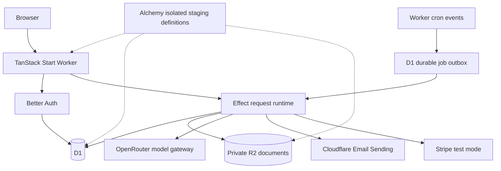

# Native Cloudflare architecture

Jesse's 2026-11-07 decision: Alchemy infrastructure, Effect server code, Better Auth sign-in and Cloudflare D1 data. This is a source migration, not a live cutover.

## Source boundaries

- `alchemy.run.ts`: staging-only resource graph, private bucket, protected D1/R2 deletion, no production route or automatic deployment.
- `src/server.ts`: Worker HTTP and scheduled-event entrypoint. Auth, RPC and uploads are server-only paths; remaining requests use TanStack SSR.
- `server/procedure.ts`: Effect procedure definitions and context; `server/contract.ts`: lightweight client contracts.
- `scripts/generate-api.mjs`: typed references and server-only registry from exported native procedures. No implementation is shipped through a browser reference.
- `server/runtime.ts`: real Better Auth session resolution, argument/entity validation, public/internal boundary, actor propagation and Effect execution. Internal procedures are not HTTP-callable.
- `server/database.ts`: native D1 SQL predicates, indexed reads, FTS5 and optimistic transactional writes. No Convex client, deployment, generated API or compatibility endpoint remains.
- `server/model.ts`: runtime entity schemas and application types. `migrations/` owns the physical D1/auth schema.
- `server/jobs.ts`: cron handoff and leased, inspectable outbox work. Child jobs retain server-owned arguments, not browser authority.
- `server/functions/` and `server/scrapers/`: migrated business rules, publication safeguards, source extraction, matching and delivery state.
- `src/lib/data.ts`: TanStack Query reads and commands over same-origin transport; keys include the session principal, invalidation follows successful commands, active reads refresh every 15 seconds.

## D1 invariants

`app_records` stores schema-validated entities as JSON with stable IDs. Collection-scoped expression indexes retain the application lookup/order paths; FTS5 owns municipality name token-prefix search. Eleven entity types are retained: users, municipalities, coverage requests, meetings, summaries, subscriptions, alerts, scrape jobs, scraper validation runs, coverage publication events and usage records.

A write reads a primary D1 session revision and stages only changed records. Queries overlay only those staged records using SQL CTEs. The commit batches a revision guard, entity changes, background jobs and revision increment together. A stale revision aborts the complete batch and retries the procedure; an exception before commit writes neither records nor jobs. Read procedures cannot write or enqueue work. External-side-effect tasks are not repeated as database transactions.

Auth tables are the Better Auth `user`, `session`, `account` and `verification` tables; application roles/tiers remain server-owned app records. Imported users map by owner-exported provider identity plus verified primary email. Runtime sign-up does not claim old rows by email. Initial ownership additionally requires the configured verified administrator address; imported administrators keep their mapped app roles.

Documents use a private R2 binding. Authenticated upload validates type/size/quota and records the owning auth principal in D1. Meeting creation rejects another principal's blob. Extraction reads R2 directly, without public upload/download links. PDF extraction uses `unpdf`; DOCX extraction reads only bounded `word/document.xml`; scanned-PDF transcription uses a raw-PDF provider request without a native image library.

## Jobs and integrations

The enabled schedules remain immediate alerts every five minutes, newly-past meetings at 07:00 UTC, daily digests at 08:00 UTC and Monday weekly digests at 08:00 UTC. A minute trigger drains due outbox entries. Formerly commented-out scraping/cleanup schedules are not silently enabled. Bulk discovery/probing, summaries and recipient delivery fan out into child jobs. Leases prevent concurrent claims; exhausted jobs stay visible with a generic failure marker. Existing alert reservations and retry transitions still guard duplicate mail delivery.

`OUTBOUND_ENABLED` defaults to false, and Alchemy staging also disables scheduled work. No paid model or mail request is made during local smoke. Mail uses dedicated `EMAIL_API_TOKEN`/`EMAIL_ACCOUNT_ID`, not an infrastructure deployment token.

Stripe checkout/portal require a test key. Webhooks verify the raw body with Web Crypto, reject live events, and call private entitlement writes. Current billing periods come from Stripe subscription items, not invented zero timestamps. Imported live customer/subscription identifiers cannot be overwritten or used by test checkout.

## Verification and transition

See `README.md` for the bounded real-surface checks, offline migration compiler, exact rehearsals, excluded checks and separately approved live-cutover requirements. The old provider installations remain deployed until an owner-approved handoff; their schedules must not overlap the new system's delivery schedules.

No unit tests, unit-test tooling, or unit-test gates. This includes delegated work and future reviews (Jesse, 2026-10-09).

Reference contracts: [Alchemy TanStack Start/D1 bindings](https://v1.alchemy.run/providers/cloudflare/tanstack-start), [Alchemy D1 migrations](https://v1.alchemy.run/providers/cloudflare/d1-database), [Effect runtime](https://effect.website/docs/runtime/), [Better Auth's native D1 setup](https://better-auth.com/docs/concepts/database#programmatic-migrations), and [D1 transactional batches](https://developers.cloudflare.com/d1/worker-api/d1-database/#batch).
